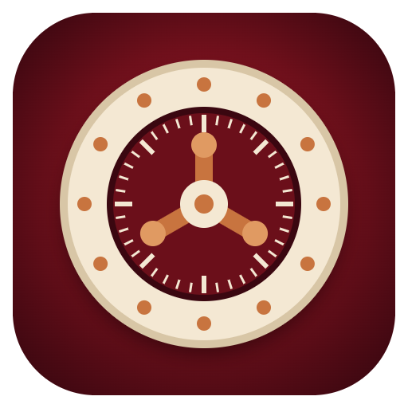
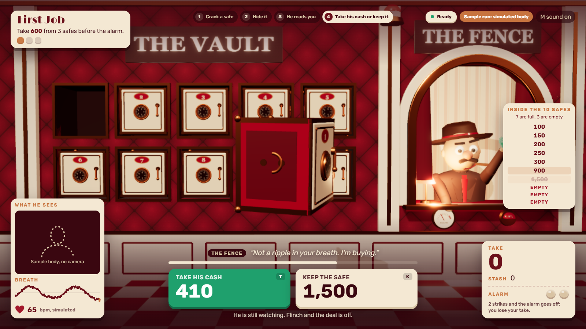
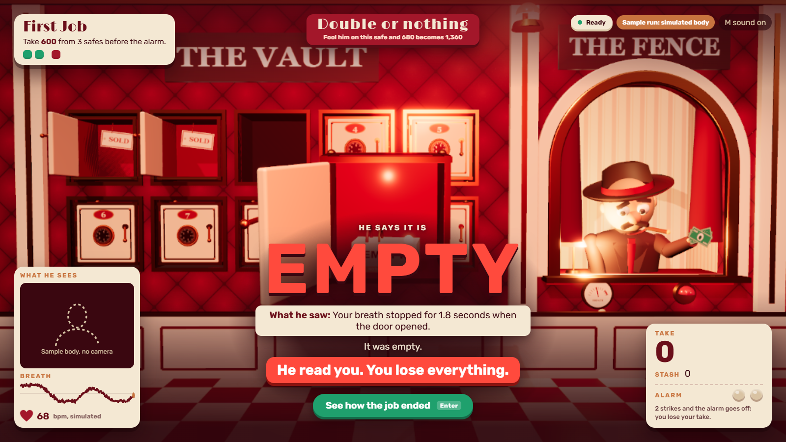

<p align="center"></p>

<h1 align="center">The Vault</h1>

<p align="center"><b>A heist game where the buyer reads your breathing.</b><br>
Crack safes, hide what you found, and sell them to The Fence. He never sees inside. He watches your body through the Presage SmartSpectra SDK and prices every safe by what it gives away.</p>

<p align="center">
  
  
  
  
</p>

<p align="center"></p>

## Judges: start here

| Path | What you see | You need | Time |
|---|---|---|---|
| **A. Sample run** | A full job played by a simulated body: the look, his live suspicion, the deal, strikes, the last safe | The installer only. No camera, no key | 2 min |
| **B. Live run** | The Fence reads *your* breathing, blinks, face and pulse and prices your safes from them | A webcam and a free Presage key from [physiology.presagetech.com](https://physiology.presagetech.com) | 3 min |

1. Download **The-Vault-Setup-0.1.0.exe** from [Releases](../../releases) and run it. The installer is not code signed, so Windows may show "Windows protected your PC": choose **More info**, then **Run anyway**.
2. Press **S** on the title screen for the sample run, or **Start the job** for live play. Live play asks once for your Presage key and keeps it encrypted on your PC.
3. For the best read: laptop at eye level, sit back an arm's length so your chest is in view, light in front of you.

## How a job plays

1. **He learns your calm.** Ten seconds of normal breathing. Your breathing trace from the SDK becomes your own baseline.
2. **Crack a safe.** Only you see inside: cash, gold bars, or nothing at all.
3. **Five seconds to hide it.** While you look, The Fence reads you live: a held breath, shallower or faster breathing, a blink burst, a smile, surprise. A suspicion bar shows what he is seeing as it happens.
4. **The deal.** He names one price for a safe he has never seen. You get five seconds to take his cash or keep what is inside. Flinch while you decide and he pulls the offer.
5. **Strikes.** Sell him an empty safe and his audit finds it: one strike. Two strikes and the alarm goes off and you lose your take.
6. **The last safe.** Walk out with your take, or bet it double or nothing on fooling him once more. He calls it FULL or EMPTY from your body alone and shows you what he saw, with the number.
7. **Your tell.** After the job he names your tell in your own numbers ("At empty safes your breath stopped for 1.2 seconds on average") and watches for it on your next job.

## Seven jobs

| Job | What changes | Opens |
|---|---|---|
| First Job | Three safes and a gentle Fence. Learn the ropes. | Open |
| The Heist | Five safes. The full game. | Open |
| Daily Heist | The same safes for everyone today. | Open |
| Speed Run | A three second look instead of five. | Open |
| Night Shift | He reads your pulse too. | 5,000 stash |
| Double Cross | Sell him an empty safe and he pays double. Get caught at one and it is a strike. | 10,000 stash |
| The Ghost | He reads everything. No hints. | 20,000 stash |

Your stash is everything you have banked across jobs. It stays on your PC.

<p align="center"></p>

## How it uses Presage SmartSpectra

The SDK is the game's only input. Every decision The Fence makes comes from what the SDK measured during your look, compared with your own calm.

| SDK output | What The Fence does with it | Code |
|---|---|---|
| Upper and lower breathing traces, breathing rate | Breath holds, shallower breathing and rate changes against your calm baseline | [features.ts](src/renderer/engine/features.ts), [baseline.ts](src/renderer/engine/baseline.ts) |
| Blinks | Blink stops and blink bursts during the look | [features.ts](src/renderer/engine/features.ts) |
| Face expressions | Smiles and surprise when the door opens | [features.ts](src/renderer/engine/features.ts) |
| Pulse | Heat on Night Shift and The Ghost | [game.ts](src/renderer/engine/game.ts) |
| Talking | Talking over the look counts as a tell | [banker.ts](src/renderer/engine/banker.ts) |
| Validation status (face, light, chest in view, frame rate) | The Line up screen and the quiet pause when your face is lost | [Lineup.tsx](src/renderer/ui/Lineup.tsx), [status.ts](src/renderer/signals/status.ts) |

* **Where the SDK runs.** The Node SDK runs natively in the Electron main process ([src/main/index.ts](src/main/index.ts)). The game opens the camera itself, keeps the camera's own exposure, and hands every frame to the SDK through custom input (`useCustomInput` and `sendFrame`), so the picture stays bright under a desk lamp. Only metrics travel to the game screen.
* **The Fence is a model of you.** A per player naive Bayes over six features, seeded with priors and updated by every safe you open or sell ([banker.ts](src/renderer/engine/banker.ts)). A signal only earns weight when your full and empty safes really separate on it.
* **Fair by design.** An incentive probe plays 400 simulated players per bank: controlled breathing beats honest leaking, and faking tells never wins in normal play ([docs/probe.md](docs/probe.md)). On the last safe his call uses your body only, never the odds of the board.

## Consent and data handling

* **Consent first.** The camera turns on only after a consent screen that says what is read. Esc turns it off at any moment.
* **Frames stay on your PC.** Camera frames go from the game to the SDK inside the same app and are never saved or uploaded.
* **What is stored.** Job results and tell summaries (numbers such as seconds of breath hold), your stash and settings, in the app's local storage on your PC. No video and no raw signal traces. **Wipe my history** on the jobs screen deletes them.
* **Your Presage key.** Saved encrypted with Windows DPAPI in `%APPDATA%\The Vault`, used only to start the SDK, and removable with **Forget my key**.
* **Network.** The SDK signs in to Presage to check the key and meter usage. SDK telemetry is turned off in this game. The Fence's voice is recorded audio shipped with the app, so no speech service is called. No analytics.
* **AI use.** The Fence is a small statistical model that runs on your PC. No language model or cloud AI ever sees your signals. Built with AI coding assistance.
* **A game, not a health product.** It reads tells, how your body reacts to what you see. It makes no health claims.

## Build from source

```bash
git clone https://github.com/jenzylove/vault
cd vault
npm install
node node_modules/electron/install.js   # npm 11 skips Electron's own download step
npm run dev                              # paste your Presage key in the game, or put PRESAGE_API_KEY=... in .env
```

* `npm test` runs the engine, rules, voice and music tests.
* `npm run dist` builds the Windows installer into `dist/`.
* `npm run voice` rerenders The Fence's lines after a copy change.

## Built with

Electron, React, three.js, the Presage SmartSpectra Node SDK, an original WebAudio score, and The Fence's voice rendered once at build time.

## License

[MIT](LICENSE)
